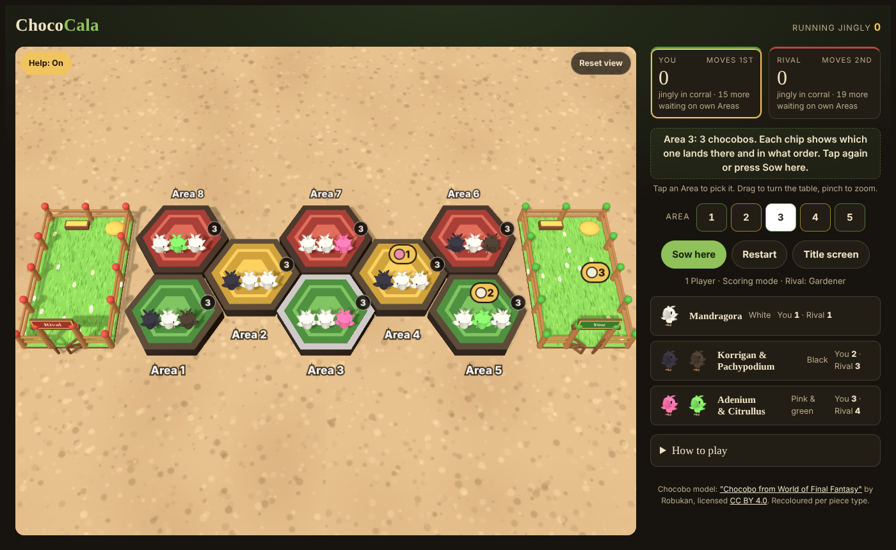

# ChocoCala

A 3D Mancala-style board game played with chocobos, based on the rules of the **Mandragora Mania** minigame from Final Fantasy XI.

Hop your chocobos around the board, land the last one in your corral for an extra turn, and finish with the most jingly penned up. The winner's flock dances in their corral under fireworks.



## Play it

| Version | How to get it |
| --- | --- |
| **Android (mobile)** | Download [`dist/ChocoCala.apk`](dist/ChocoCala.apk) on your phone and open it. Android will ask you to allow installs from your browser or file manager the first time. |
| **Desktop (any browser)** | Download [`dist/ChocoCala.html`](dist/ChocoCala.html) and double-click it. It's one self-contained file and works offline. |
| **Web / GitHub Pages** | The `docs/` folder is the web version. In the repo's **Settings → Pages**, choose *Deploy from a branch*, branch `main`, folder `/docs`, to play it at `https://<user>.github.io/ChocoCala/`. |

The game needs WebGL, which every current desktop browser and Android phone supports.

## Features

- **Title screen:** 1 Player (vs the Rival, three strengths) or 2 Players (pass and play on one device).
- **Two modes:**
  - *Classic*: every chocobo is worth 1 jingly.
  - *Scoring*: coloured chocobos are worth different amounts.
- **Help toggle:** shows the Area 1–8 labels, the chocobo count on each Area, and where the selected move will send each chocobo.
- **3D board:** drag to turn the table, pinch or scroll to zoom. Chocobos hop from Area to Area, and scored chocobos roam their corral.
- **Victory scene:** night falls, the camera drops to ground level, and the winning flock dances while fireworks go off.
- **Full-screen game:** after *Start game* the board fills the screen in landscape. The only on-screen controls are *Help*, *Reset view* and a HUD showing both scores and whose turn it is.
  - The Android app locks to landscape and hides the system bars.
  - Browsers go full screen where they allow it.
  - **Main menu** (bottom-left), Back (Android) or <kbd>Esc</kbd> (desktop) leaves the game. Mid-game, it asks before quitting.
- **2 players face to face:** lay the phone flat between you.
  - When it's Player 2's turn, the camera swings over the board to their side, the chocobos turn to face them, and the HUD and buttons flip.
  - Player 2's corral faces them, and if Player 2 wins, the victory scene plays from their side.
- **Sound:**
  - Each chocobo hop plays a sound.
  - The victory scene has a fanfare, chirping chocobos and firework explosions.
  - Sound can be switched on or off on the title screen.
- **Desktop keys:** <kbd>1</kbd>–<kbd>8</kbd> pick an Area, <kbd>Enter</kbd> sows, <kbd>H</kbd> toggles help, <kbd>R</kbd> resets the view, <kbd>Esc</kbd> returns to the title screen.

## Rules

- The board has 8 Areas and 2 corrals. Areas 1, 3 and 5 (green, front) belong to the first player, Areas 6, 7 and 8 (red, back) to the second player, and Areas 2 and 4 (yellow) are shared.
- Each Area starts with three chocobos.
- On your turn, pick one of your Areas or a shared Area. Its chocobos are placed one at a time, **starting from the rear**, along your track:
  - First player: 1 → 2 → 3 → 4 → 5 → your corral → 6 → 4 → 7 → 2 → 8
  - Second player: 6 → 4 → 7 → 2 → 8 → their corral → 1 → 2 → 3 → 4 → 5
- The opponent's corral is skipped, so you never score for them.
- If your last chocobo lands in your own corral, you take another turn.
- The game ends when the play area is empty, or when the player to move has no chocobos to pick up.
- When the game ends, chocobos still on each player's own Areas hop into that player's corral and score for them: Areas 1, 3, 5 for the first player, Areas 6, 7, 8 for the second player. Chocobos left on the shared Areas 2 and 4 don't count.
- Highest jingly in their corral wins.

**Scoring mode values** (the second player gets more to make up for moving second):

| Chocobo | First player | Second player |
| --- | --- | --- |
| Pink & green (Adenium & Citrullus) | 3 | 4 |
| Black (Korrigan & Pachypodium) | 2 | 3 |
| White (Mandragora) | 1 | 1 |

## Project layout

```
src/chococala.html      Game source (HTML/CSS/JS, three.js r128)
src/assets/chocobo.glb  Chocobo 3D model (embedded into the builds)
src/assets/sounds/      Hop, fanfare and chirp sounds (embedded into the builds)
tools/build.py          Builds docs/, dist/ChocoCala.html and android/assets/
docs/                   Web / desktop version (+ vendor/three.js files)
android/                Android app: a WebView activity (smali) and build tools
dist/                   Ready-to-use builds: ChocoCala.apk, ChocoCala.html
```

### Building

```sh
python3 tools/build.py   # web + desktop builds
android/build.sh         # Android APK (Java 17+, Python 3, npm)
```

`android/build.sh` does not need the Android SDK. It uses [ARSCLib](https://github.com/REAndroid/ARSCLib) to:
- compile the smali activity to `classes.dex`,
- write the binary manifest and resource table.

It then signs the APK with Google's `apksig` (v2 and v3 schemes). Both libraries come from the `autojs6-apkbuilder` npm package.

Set `KEYSTORE`, `KEYSTORE_PASS` and `KEY_ALIAS` to sign with your own key. Android only installs an update over an existing install if both are signed with the same key.

## Credits

- Chocobo model: ["Chocobo from World of Final Fantasy"](https://sketchfab.com/3d-models/chocobo-from-world-of-final-fantasy-329f0b6d71f245e89ff6cf8371180025) by Robukan, licensed [CC BY 4.0](http://creativecommons.org/licenses/by/4.0/). It is recoloured per piece type.
- [three.js](https://threejs.org) r128, MIT licence (`docs/vendor/LICENSE-three.txt`).
- Sound effects:
  - "Cartoon Blinking" by Dragon Studio (hop)
  - "Victory Fanfare" by Universfield
  - "Bird Sing in Cartoon" by Pixelpond (chirping)
  - The firework explosions are synthesized in the game.
- Game rules adapted from Mandragora Mania in Final Fantasy XI.

ChocoCala is an unofficial fan project and is not affiliated with Square Enix. Final Fantasy, chocobo and Mandragora Mania are trademarks of Square Enix.
